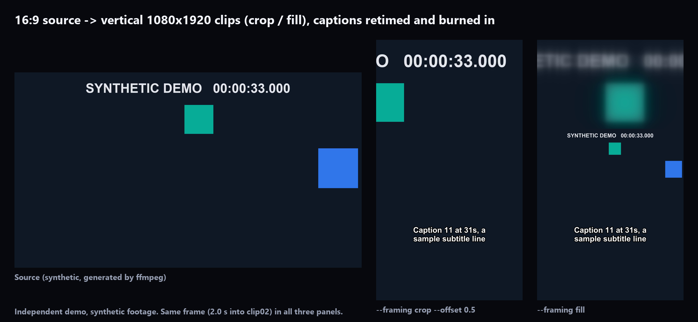

# Demo C: vertical Shorts from long videos (Python + FFmpeg)

> **Independent demonstration project, not client work.** The source video and captions are synthetic,
> generated by ffmpeg in `make_sample.py`. No third-party footage is used.

A small command-line tool that cuts a long 16:9 video into vertical 1080x1920 clips. For each clip in a JSON list it:

- makes a **frame-accurate cut** (re-encoded), H.264 + AAC, at the **source frame rate**;
- applies **framing**: `crop` (centre crop with `--offset` left/right) or `fill` (the full 16:9 frame over a blurred, enlarged copy);
- burns in **captions** retimed from one SRT for the whole video. Lines crossing the clip's start or end are **trimmed, not dropped**. White text, black outline, lower third, with font file, size and position as options;
- normalises loudness to **-14 LUFS** (two-pass `loudnorm`);
- writes a **6-frame contact sheet** (JPG);
- reports a bad clip (for example, times past the end of the video) in `report.json` and keeps rendering the others.



## Verified results

`verify.py` checks every output automatically:

- size, codecs and frame rate;
- duration within one frame;
- integrated loudness, measured with `ebur128`;
- caption on/off at 13 probe times per clip, including the trimmed first and last cues;
- the first output frame matches the source frame at the requested start better than either neighbouring frame;
- the contact sheet exists;
- the out-of-range clip is reported while the other clips still render.

| Platform | Result | Evidence |
| --- | --- | --- |
| Windows 11 x64, ffmpeg 2026-05 essentials build, Python 3.12 | **23/23 PASS (fill), 23/23 PASS (crop)** | local run 2026-10-20 (`out/` is not committed; rerun the commands below to reproduce) |
| macOS 15 Apple Silicon (GitHub Actions `macos-15`, Homebrew ffmpeg) | Pending first CI run | Actions tab, artifact `evidence-macos-15` |
| Windows (GitHub Actions `windows-latest`) | Pending first CI run | Actions tab |
| Ubuntu (GitHub Actions `ubuntu-latest`) | Pending first CI run | Actions tab |

No platform is claimed as tested until its row says PASS with evidence.

## Run it

```bash
python make_sample.py                     # synthetic source, captions.srt, clips.json
python shorts.py --input sample/source_16x9.mp4 --clips sample/clips.json --srt sample/captions.srt --framing fill --out out/fill
python shorts.py --input sample/source_16x9.mp4 --clips sample/clips.json --srt sample/captions.srt --framing crop --offset 0.5 --out out/crop
python verify.py out/fill sample
python verify.py out/crop sample
```

Requirements: Python 3.10+, ffmpeg + ffprobe on PATH (libass optional; without it captions are drawn with Pillow), and `pip install -r requirements.txt` (numpy for verification; pillow for font names and evidence images).

## License

MIT (see `LICENSE`). All code and sample media in this repository are original; the sample video and captions
are generated by `make_sample.py`.

## Options

| Option | Default | Meaning |
| --- | --- | --- |
| `--input` | required | Long 16:9 video |
| `--clips` | required | JSON `{"clips": [{"name", "start": "HH:MM:SS.mmm", "end"}]}` |
| `--srt` | none | Captions for the whole long video |
| `--framing` | `fill` | `crop` or `fill` |
| `--offset` | `0` | Crop only: -1 = left edge, 0 = centre, 1 = right edge |
| `--font` | system sans | Caption font file |
| `--font-size` | `64` | Caption size in output pixels |
| `--caption-y` | `0.78` | Caption baseline as a fraction of height |
| `--lufs` | `-14` | Integrated loudness target |
| `--caption-renderer` | `auto` | `libass` when available, otherwise `image` (Pillow PNG overlays) |
| `--out` | `out` | Output folder (clips, contact sheets, report.json) |

## macOS / Homebrew note

On GitHub's `macos-15` Apple Silicon runner, Homebrew's ffmpeg (9.0.1 at the time of the first run) was built
**without libass and freetype**, so the `ass`, `subtitles` and `drawtext` filters do not exist. The first CI run
caught this. The tool now draws captions as transparent PNGs with Pillow and composites them with ffmpeg's
built-in `overlay` filter whenever libass is missing (`--caption-renderer auto`, the default). CI exercises both
renderers on every OS.

## Design notes

Captions are written as ASS with an explicit 1080x1920 canvas. A plain SRT is laid out by libass on a
384x288 default canvas, which silently mis-scales font size and margins. This bug appeared during
development (captions rendered off-screen); the verification's caption probes now catch it.
